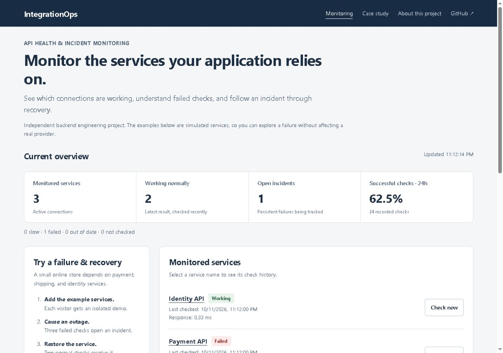

# IntegrationOps — API Health & Incident Monitoring

**Monitor the external services your application relies on, with a clear record of failure and recovery.**

IntegrationOps checks API connections, records what happened, and tracks persistent failures as incidents. The interface explains the results in everyday language; the source shows the job scheduling, database coordination, and testing behind them.

[Live site](https://integrationops.onrender.com/) · [About this project](https://integrationops.onrender.com/about) · [API documentation](https://integrationops.onrender.com/docs) · [Run locally](#run-locally) · [Validation evidence](docs/VALIDATION.md)



## Why this project exists

An online store can load normally while its payment service is unavailable. Shipping requests might be too slow, or an identity provider might reject an expired access token.

Checking whether the store itself is online does not explain those failures. Each connection needs its own checks, response validation, and history.

IntegrationOps monitors those dependencies individually. It distinguishes access errors, rate limits, timeouts, connection failures, unexpected data, and slow responses. Repeated failures open an incident; confirmed normal responses resolve it.

**Intended users:** backend, integration, platform, and reliability engineers investigating external API health.

**Project context:** an independent engineering portfolio project. The public examples use simulated providers. The measurements below come from controlled experiments, not production customers or measured business savings.

## Try it without technical setup

1. Select **Add example services** to create Payment API, Shipping API, and Identity API in your own demo session.
2. Choose a service and select **Cause outage · 3 checks**. Repeated service errors open an incident.
3. Select **Restore service · 2 checks**. Two normal responses resolve it.
4. Select a service name to inspect its **check history and incident timeline**.
5. Expand **Explore other failure types** to try access denied, rate limiting, slow responses, unexpected response data, or a timeout.
6. Select **Run the case study** for an 11-check sequence on the Payment API.

Visitors have separate signed demo sessions and independent provider state. Public controls cannot configure arbitrary URLs or change someone else's services. Demo actions are limited to 60 per session per minute; inactive demo data expires after 24 hours.

Render's hosting can display a startup screen while the service wakes up. The screenshot and this guide remain available during startup.

## What the results mean

| Display         | Meaning                                                                                       |
| --------------- | --------------------------------------------------------------------------------------------- |
| **Working**     | The response matches the expected status/data and arrives within its response-time threshold. |
| **Slow**        | The response is acceptable but slower than expected.                                          |
| **Failed**      | The check cannot connect, times out, or receives an unacceptable response.                    |
| **Out of date** | No recent check arrived within the expected interval plus the configured grace period.        |
| **Not checked** | No result has been recorded yet.                                                              |

The default policy opens an incident after **three consecutive Failed checks** and resolves it after **two consecutive Working checks**. Slow responses do not resolve an incident.

Successful-check percentage is calculated from recorded checks over 24 hours. Valid slow responses count as successful for this measure. It is not continuous uptime measurement or a service-level guarantee.

## What it demonstrates

| Capability               | Practical purpose                                         | Implementation                                                         |
| ------------------------ | --------------------------------------------------------- | ---------------------------------------------------------------------- |
| Scheduled checks         | Observe dependencies without waiting for a user report    | Local async scheduler or Celery Beat/Redis/workers                     |
| Failure classification   | Distinguish different kinds of integration failure        | Bounded HTTP probes, expected status and JSON-field validation         |
| Persistent run IDs       | Retried delivery reuses a completed result                | Database-owned check runs and execution IDs                            |
| Atomic claims and leases | Coordinate overlapping workers and recover abandoned work | Conditional updates, expiring claims, partial unique indexes           |
| Transactional incidents  | Commit results and incident transitions together          | SQLAlchemy, row locking in PostgreSQL, serialized SQLite writes        |
| Notification outbox      | Preserve an incident when Slack is unavailable            | Committed delivery records, bounded retries, transition deduplication  |
| Freshness and readiness  | Distinguish provider health from monitor health           | Last-check age, scheduler/worker heartbeats, database/broker checks    |
| Worker-visible metrics   | Observe work done in separate processes                   | Database-backed Prometheus collector and provisioned Grafana dashboard |
| Safer configuration      | Keep public demo actions separate from real monitoring    | Operator bearer token, encrypted headers, DNS-pinned public targets    |
| Repeatable validation    | Inspect the behavior rather than trust a tool list        | Regression tests, browser tests, distributed and restart experiments   |

**Tools:** Python 3.12 · FastAPI · SQLAlchemy · HTTPX · HTTPCore · Celery · Redis · PostgreSQL · SQLite · Alembic · Fernet · Prometheus · Grafana · Docker Compose · PyTest · Playwright · GitHub Actions

## Architecture

```text
Browser: monitoring / service history / About
                       |
                    FastAPI
                       |
             PostgreSQL / SQLite
        configuration, runs, checks, incidents,
        notification outbox, heartbeats, metrics

Scheduled worker mode:
Celery Beat -> persisted run -> Redis -> worker claims run
                                            |
                                      external API probe
                                            |
                        one transaction: result + incident + outbox

Notification worker -> Slack webhook (bounded retry)
Prometheus -> API database-backed metrics -> Grafana
```

A run is persisted before queue publication. If publication or a worker is interrupted, its lease allows the scheduler to retry the **same logical run**. A completed run returns its stored result without repeating incident transitions.

The worker makes the network request outside the final database transaction. Final persistence checks the claim token, locks the service row, records the result, updates incident state, and queues any notification. A superseded worker cannot commit using an old claim.

The lightweight mode runs bounded asynchronous checks in the API process. The distributed mode uses PostgreSQL, Redis, Celery Beat, and separate workers. Manual checks return HTTP 202 in worker mode; clients poll the persisted run until it completes.

## Measured experiments

[Raw workload results](docs/validation/benchmark.json) · [Query comparison](docs/validation/query-experiment.json) · [Restart experiment](docs/validation/restart-experiment.json)

| Experiment                                                                         | Observed result                                                                         |
| ---------------------------------------------------------------------------------- | --------------------------------------------------------------------------------------- |
| 100 synthetic services, 2 workers, 30-second check interval, 90-second observation | 300 completed checks; all 100 services checked; no duplicate persisted execution IDs    |
| Operator overview while the workload ran                                           | p95 response latency: **12.195 ms**, from 176 samples                                   |
| Scheduling delay in that workload                                                  | p95: **7.551 seconds**                                                                  |
| Latest-result lookup for 100 services, 20 repetitions                              | SQL statements reduced from **100 to 1**; median lookup time **36.278 ms to 2.301 ms**  |
| Worker killed during a claimed check                                               | Same run recovered in **66.25 seconds**, with 2 attempts and exactly 1 persisted result |
| API restarted while an incident was open                                           | Persisted incident and exported metrics remained available                              |

These are observations from one local Docker/WSL2 environment. Providers were synthetic HTTPX transports; 20% returned a delayed 0.8-second response. The workload is not a production capacity, continuous availability, or business-impact claim. See the evidence files for settings and limitations.

## Run locally

```bash
python -m venv .venv
# macOS / Linux
source .venv/bin/activate
# Windows PowerShell
# .\.venv\Scripts\Activate.ps1
pip install -r requirements-core.txt
# Copy .env.example to .env with your shell or file manager.
uvicorn app.main:app --reload
```

- Monitoring: <http://localhost:8000>
- About: <http://localhost:8000/about>
- API documentation: <http://localhost:8000/docs>
- Metrics: <http://localhost:8000/metrics>

SQLite migrations run automatically in the local mode. Set `SCHEDULER_ENABLED=false` for a manual-only preview.

For the complete stack:

```bash
docker compose up --build -d --wait
```

API **8000** · Prometheus **9090** · Grafana **3001**

Compose ports bind to localhost. PostgreSQL and Redis have readiness checks, and migrations complete before dependent services start. The supplied Grafana dashboard covers incidents, check throughput, duration, queued runs, heartbeats, and exhausted notification retries.

The optional Next.js entry point redirects to the primary interface and About page, avoiding two different dashboards. Set `NEXT_PUBLIC_API_URL` before its build if you use it.

## Operator configuration and security

The public demo needs no account. Real integration configuration requires `Authorization: Bearer <OPERATOR_TOKEN>`. There is no public registration or multi-tenant administration.

Configure `INTEGRATION_SECRET_KEY` before storing custom headers. Generate a Fernet key once:

```bash
python -c "from cryptography.fernet import Fernet; print(Fernet.generate_key().decode())"
```

Request headers are encrypted at rest and omitted from API read responses. Legacy plaintext headers fail closed until explicitly migrated:

```bash
python -m scripts.encrypt_legacy_headers       # counts legacy records
python -m scripts.encrypt_legacy_headers --apply
```

External probes use path-only URLs and reject local/private/reserved addresses, embedded URL credentials, and unsafe DNS answers. Query-string targets are unsupported; supply credentials through encrypted headers. Headers are sent only over HTTPS. The transport connects to the validated IP while preserving the original hostname for HTTP and TLS. Redirects are disabled; environment proxy settings are ignored. Response bodies are limited to 64 KiB and checks have a total deadline.

Production settings require a stable session secret, an operator token of at least 32 characters, secure cookies, and HTTPS. Keep keys outside Git. Review [deployment guidance](docs/DEPLOYMENT.md), including network egress restrictions.

## Validation and operations

```bash
pytest -q
python -m compileall -q app migrations scripts
docker compose exec -T api python -m scripts.distributed_smoke
```

Browser tests are in `e2e/`. CI runs backend tests, the frontend build, desktop/mobile browser workflows, the real distributed smoke test, and isolated PostgreSQL concurrency tests.

- [Validation record](docs/VALIDATION.md)
- [Troubleshooting runbook](docs/RUNBOOK.md)
- [Incident and recovery decision](docs/adr/001-incident-policy.md)
- [Run claims and replay decision](docs/adr/002-check-runs.md)
- [Freshness and metrics decision](docs/adr/003-observability.md)

Health endpoints separate process liveness (`/api/health/live`) from monitoring readiness (`/api/health/ready`). In distributed mode, readiness includes the database, broker, and recent scheduler/worker activity.

History retention defaults to 30 days. The most recent check for each service is preserved; resolved incident detail and terminal run records expire according to retention. Lifetime metric totals remain persisted.

## Current boundaries

This is a tested portfolio implementation with controlled fault experiments. It does not automatically repair providers, infer their internal root cause, offer continuous uptime guarantees, or implement commercial tenant administration.

Slack delivery uses retryable at-least-once semantics with a maximum attempt count. A message can repeat if delivery succeeds immediately before a worker crashes; exhausted attempts remain visible for operator action.

Public demo sessions are signed and isolated but are not user accounts. Deployments need appropriate HTTPS, durable storage, secret management, backups, and network controls. The SQLite mode is intended for a single local application process; use PostgreSQL for the distributed stack.
